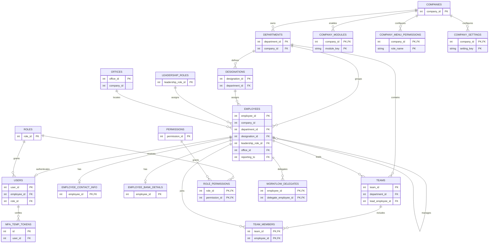
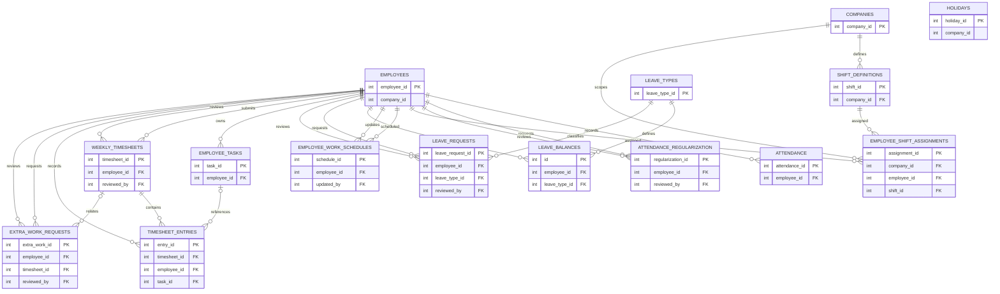
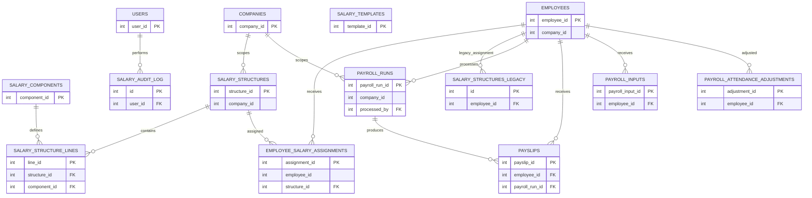

# HRMS Phase 1 — ER diagram

## Confirmed project configuration

The existing repository is the source of truth for the initial architecture:

| Area | Phase 1 decision | Evidence |
|---|---|---|
| Frontend | React 19, JavaScript | Root `package.json` |
| Backend | Node.js, Express | `backend/package.json`, `backend/src/server.js` |
| Database | MySQL, one shared database, tenant scope on company-owned rows | `backend/src/config/db.js`, `backend/database/schema.sql`, migration 059 |
| Application shape | Modular monolith | Single React app and Express API |
| Business coverage | India first, with country, IANA timezone, and currency company defaults | `backend/database/migration_059_company_foundation.sql` |

This document maps entities present in the base schema and table-creating migrations. The diagram shows declared foreign keys; ownership references that are only enforced in services or procedures are explicitly called out below. It does not imply that proposed SaaS billing or platform administration tables already exist.

## Tenant and organization, authentication, and authorization

## Attendance, schedules, leave, and timesheets

## Compensation and payroll

`salary_structures` appears in the original schema as an employee-linked legacy table and is recreated by migration 041 as a company-owned structure catalog. The current migration chain must be treated as authoritative for deployed shape; the two shapes cannot be represented as one stable entity without reconciling the old and new models. The diagram labels the former `SALARY_STRUCTURES_LEGACY` to make that migration conflict visible.

## Recruitment, interviews, offers, and onboarding

```mermaid
erDiagram
  USERS {
    int user_id PK
  }
  EMPLOYEES {
    int employee_id PK
  }
  JOBS {
    int job_id PK
    int department_id FK
    int created_by FK
  }
  JOB_APPLICATIONS {
    int application_id PK
    int job_id FK
    int applicant_employee_id FK
  }
  REFERRALS {
    int referral_id PK
    int job_id FK
    int referred_by FK
  }
  REC_JOB_REQUESTS {
    int job_req_id PK
    int created_by FK
  }
  REC_JOB_RECRUITERS {
    int id PK
    int job_req_id FK
    int recruiter_id FK
    int assigned_by FK
  }
  REC_CANDIDATES {
    int candidate_id PK
    int job_req_id FK
    int recruiter_id FK
    int created_by FK
  }
  REC_INTERVIEWS {
    int interview_id PK
    int candidate_id FK
    int job_req_id FK
    int scheduled_by FK
  }
  REC_OFFERS {
    int offer_id PK
    int candidate_id FK
    int job_req_id FK
    int created_by FK
  }
  REC_ONBOARDING {
    int onboarding_id PK
    int candidate_id FK
    int offer_id FK
    int created_by FK
  }
  JOINING_INVITATIONS {
    int id PK
    int candidate_id
    int offer_id
  }
  JOINING_FORMALITIES {
    int id PK
    int invitation_id FK
    int candidate_id
  }
  REC_RESUME_PARSER_LOGS {
    int log_id PK
    int candidate_id FK
  }
  REC_CANDIDATE_SKILLS {
    int skill_id PK
    int candidate_id FK
  }
  REC_CANDIDATE_EDUCATION {
    int edu_id PK
    int candidate_id FK
  }
  REC_CANDIDATE_EXPERIENCE {
    int exp_id PK
    int candidate_id FK
  }
  AI_INTERVIEW_SESSIONS {
    int session_id PK
    int candidate_id
    int job_req_id
    int recruiter_id
    int plan_id
  }
  AI_INTERVIEW_PLANS {
    int plan_id PK
    int job_req_id FK
  }
  AI_INTERVIEW_PLAN_QUESTIONS {
    int question_id PK
    int plan_id FK
  }
  REC_AUDIT_LOG {
    int log_id PK
    int performed_by FK
  }

  JOBS ||--o{ JOB_APPLICATIONS : receives
  EMPLOYEES o|--o{ JOB_APPLICATIONS : applies
  JOBS ||--o{ REFERRALS : receives
  EMPLOYEES ||--o{ REFERRALS : refers
  USERS ||--o{ REC_JOB_REQUESTS : creates
  REC_JOB_REQUESTS ||--o{ REC_JOB_RECRUITERS : assigned
  EMPLOYEES ||--o{ REC_JOB_RECRUITERS : recruits
  USERS ||--o{ REC_JOB_RECRUITERS : assigns
  REC_JOB_REQUESTS ||--o{ REC_CANDIDATES : contains
  EMPLOYEES o|--o{ REC_CANDIDATES : recruits
  USERS ||--o{ REC_CANDIDATES : creates
  REC_CANDIDATES ||--o{ REC_INTERVIEWS : interviewed
  REC_JOB_REQUESTS ||--o{ REC_INTERVIEWS : schedules
  USERS ||--o{ REC_INTERVIEWS : schedules
  REC_CANDIDATES ||--o{ REC_OFFERS : offered
  REC_JOB_REQUESTS ||--o{ REC_OFFERS : for_role
  USERS ||--o{ REC_OFFERS : creates
  REC_CANDIDATES ||--o{ REC_ONBOARDING : onboards
  REC_OFFERS ||--o| REC_ONBOARDING : starts
  USERS ||--o{ REC_ONBOARDING : creates
  REC_CANDIDATES ||--o{ JOINING_INVITATIONS : invited
  REC_OFFERS ||--o{ JOINING_INVITATIONS : invitation
  JOINING_INVITATIONS ||--o| JOINING_FORMALITIES : collects
  REC_CANDIDATES ||--o{ JOINING_FORMALITIES : submits
  REC_CANDIDATES o|--o{ REC_RESUME_PARSER_LOGS : parsed
  REC_CANDIDATES ||--o{ REC_CANDIDATE_SKILLS : has
  REC_CANDIDATES ||--o{ REC_CANDIDATE_EDUCATION : has
  REC_CANDIDATES ||--o{ REC_CANDIDATE_EXPERIENCE : has
  REC_CANDIDATES ||--o{ AI_INTERVIEW_SESSIONS : interviewed
  REC_JOB_REQUESTS ||--o{ AI_INTERVIEW_SESSIONS : interview_for
  REC_JOB_REQUESTS ||--o{ AI_INTERVIEW_PLANS : plans
  AI_INTERVIEW_PLANS ||--o{ AI_INTERVIEW_PLAN_QUESTIONS : contains
  AI_INTERVIEW_PLANS o|--o{ AI_INTERVIEW_SESSIONS : uses
  USERS ||--o{ REC_AUDIT_LOG : performs
```

The AI interview session, joining invitation, and joining form tables contain candidate/job/offer identifiers without declared foreign keys in their creating migrations. Their links in the diagram are logical references; the database does not guarantee their integrity.

## Reviews, declarations, exit, service, and culture

```mermaid
erDiagram
  EMPLOYEES {
    int employee_id PK
  }
  REVIEW_TYPES {
    int review_type_id PK
  }
  REVIEWS {
    int review_id PK
    int review_type_id FK
    int employee_id FK
    int reviewer_id FK
  }
  APPRAISAL_CYCLES {
    int cycle_id PK
  }
  SELF_APPRAISALS {
    int appraisal_id PK
    int cycle_id FK
    int employee_id FK
  }
  APPRAISAL_RATINGS {
    int rating_id PK
    int appraisal_id FK
  }
  APPRAISAL_ENROLLMENTS {
    int enrollment_id PK
    int cycle_id FK
    int employee_id FK
    int enrolled_by FK
  }
  IT_DECLARATION_CYCLES {
    int cycle_id PK
    int created_by FK
  }
  IT_DECLARATIONS {
    int declaration_id PK
    int cycle_id FK
    int employee_id FK
    int reviewed_by FK
  }
  IT_DECLARATION_ITEMS {
    int item_id PK
    int declaration_id FK
  }
  IT_PROOF_DOCUMENTS {
    int proof_id PK
    int declaration_id FK
    int employee_id FK
    int reviewed_by FK
  }
  RESIGNATIONS {
    int resignation_id PK
    int employee_id FK
    int reviewed_by FK
    int manager_reviewed_by FK
  }
  REQUEST_HUB {
    int request_id PK
    int employee_id FK
    int reviewed_by FK
  }
  HELPDESK_TICKETS {
    int ticket_id PK
    int employee_id FK
    int assigned_to FK
  }
  HELPDESK_COMMENTS {
    int id PK
    int ticket_id FK
    int commented_by FK
  }
  DOCUMENT_CATEGORIES {
    int category_id PK
  }
  DOCUMENTS {
    int document_id PK
    int category_id FK
    int employee_id FK
    int uploaded_by FK
  }
  KUDOS_CATEGORIES {
    int category_id PK
  }
  KUDOS {
    int kudos_id PK
    int from_employee_id FK
    int to_employee_id FK
    int category_id FK
  }
  FEEDBACK_REQUESTS {
    int request_id PK
    int requester_employee_id FK
    int reviewer_employee_id FK
  }
  EMPLOYEE_FEEDBACK {
    int feedback_id PK
    int from_employee_id FK
    int to_employee_id FK
    int category_id FK
    int request_id FK
  }
  CALENDAR_EVENTS {
    int event_id PK
    int created_by FK
  }
  REPORTING_HISTORY {
    int history_id PK
    int employee_id FK
    int old_manager_id FK
    int new_manager_id FK
    int changed_by FK
  }
  AUDIT_LOGS {
    int id PK
    int user_id
    int company_id
  }
  NOTIFICATION_LOG {
    int id PK
    int user_id
    int employee_id
  }

  REVIEW_TYPES ||--o{ REVIEWS : classifies
  EMPLOYEES ||--o{ REVIEWS : receives
  EMPLOYEES o|--o{ REVIEWS : reviews
  APPRAISAL_CYCLES ||--o{ SELF_APPRAISALS : contains
  EMPLOYEES ||--o{ SELF_APPRAISALS : submits
  SELF_APPRAISALS ||--o{ APPRAISAL_RATINGS : rated
  APPRAISAL_CYCLES ||--o{ APPRAISAL_ENROLLMENTS : enrolls
  EMPLOYEES ||--o{ APPRAISAL_ENROLLMENTS : enrolled
  EMPLOYEES o|--o{ APPRAISAL_ENROLLMENTS : enrolls
  EMPLOYEES o|--o{ IT_DECLARATION_CYCLES : creates
  IT_DECLARATION_CYCLES ||--o{ IT_DECLARATIONS : contains
  EMPLOYEES ||--o{ IT_DECLARATIONS : declares
  EMPLOYEES o|--o{ IT_DECLARATIONS : reviews
  IT_DECLARATIONS ||--o{ IT_DECLARATION_ITEMS : itemizes
  IT_DECLARATIONS ||--o{ IT_PROOF_DOCUMENTS : supports
  EMPLOYEES ||--o{ IT_PROOF_DOCUMENTS : uploads
  EMPLOYEES o|--o{ IT_PROOF_DOCUMENTS : reviews
  EMPLOYEES ||--o{ RESIGNATIONS : resigns
  EMPLOYEES o|--o{ RESIGNATIONS : reviews
  EMPLOYEES ||--o{ REQUEST_HUB : submits
  EMPLOYEES o|--o{ REQUEST_HUB : reviews
  EMPLOYEES ||--o{ HELPDESK_TICKETS : opens
  EMPLOYEES o|--o{ HELPDESK_TICKETS : assigned
  HELPDESK_TICKETS ||--o{ HELPDESK_COMMENTS : has
  EMPLOYEES ||--o{ HELPDESK_COMMENTS : writes
  DOCUMENT_CATEGORIES o|--o{ DOCUMENTS : classifies
  EMPLOYEES o|--o{ DOCUMENTS : owns
  EMPLOYEES o|--o{ DOCUMENTS : uploads
  EMPLOYEES ||--o{ KUDOS : gives
  EMPLOYEES ||--o{ KUDOS : receives
  KUDOS_CATEGORIES o|--o{ KUDOS : classifies
  EMPLOYEES ||--o{ FEEDBACK_REQUESTS : requests
  EMPLOYEES ||--o{ FEEDBACK_REQUESTS : reviews
  EMPLOYEES ||--o{ EMPLOYEE_FEEDBACK : gives
  EMPLOYEES ||--o{ EMPLOYEE_FEEDBACK : receives
  KUDOS_CATEGORIES o|--o{ EMPLOYEE_FEEDBACK : classifies
  FEEDBACK_REQUESTS o|--o{ EMPLOYEE_FEEDBACK : answered_by
  EMPLOYEES o|--o{ CALENDAR_EVENTS : creates
  EMPLOYEES ||--o{ REPORTING_HISTORY : changes
  EMPLOYEES o|--o{ REPORTING_HISTORY : former_manager
  EMPLOYEES o|--o{ REPORTING_HISTORY : new_manager
  EMPLOYEES o|--o{ REPORTING_HISTORY : records
```

`audit_logs` has a nullable employee/user identifier and a nullable company scope but no declared foreign key. `notification_log` likewise stores user/employee identifiers without declared foreign keys. These are intentional loose-coupling patterns in the current migrations.

## Tenant boundaries and model gaps

- `company_id` is the tenant boundary. The current migration adds it to `employees`, `offices`, `holidays`, `payroll_runs`, `salary_structures`, and `audit_logs`; many dependent rows inherit tenant ownership through their employee, department, job request, or payroll run.
- Direct `company_id` foreign keys are present for departments and the company module/settings/shift tables. Other newly added tenant columns are not backed by company foreign keys or composite tenant-aware foreign keys.
- Shared lookup data including roles, permissions, leave types, review types, and document categories is global in the existing model. If tenants need different definitions, those tables need explicit tenant ownership or a global-default plus tenant-override design.
- `company_menu_permissions` keys permissions by a free-text `role_name`, unlike the global numeric `roles.role_id` used by `role_permissions`.
- No subscription plan, subscription history, billing event, tenant user/employee limit, or platform super-admin entity is present in the schema. They belong in a later SaaS-platform ERD extension, not in this as-is diagram.
- No complete ERD can be considered a migration-ready schema until the legacy and new `salary_structures` shapes are reconciled and tenant references/FKs are reviewed against a live database.

## Sources

- [Base MySQL schema](../backend/database/schema.sql)
- [Company foundation migration](../backend/database/migration_059_company_foundation.sql)
- [Timesheet migration](../backend/database/migration_008_timesheet.sql)
- [Salary component migration](../backend/database/migration_041_salary_components.sql)
- [Recruitment migration](../backend/database/migration_034_recruitment_module.sql)
- Other entities are declared in their corresponding `backend/database/migration_*.sql` files.
